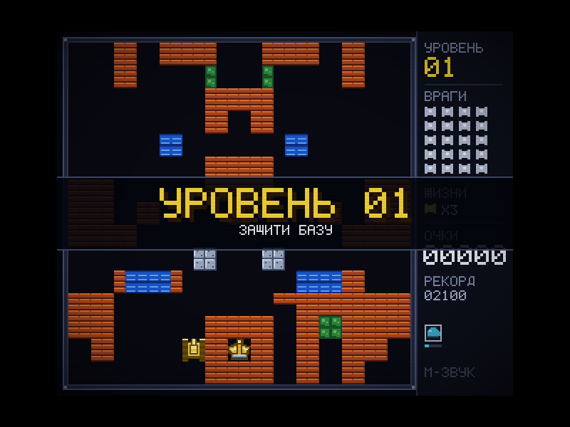
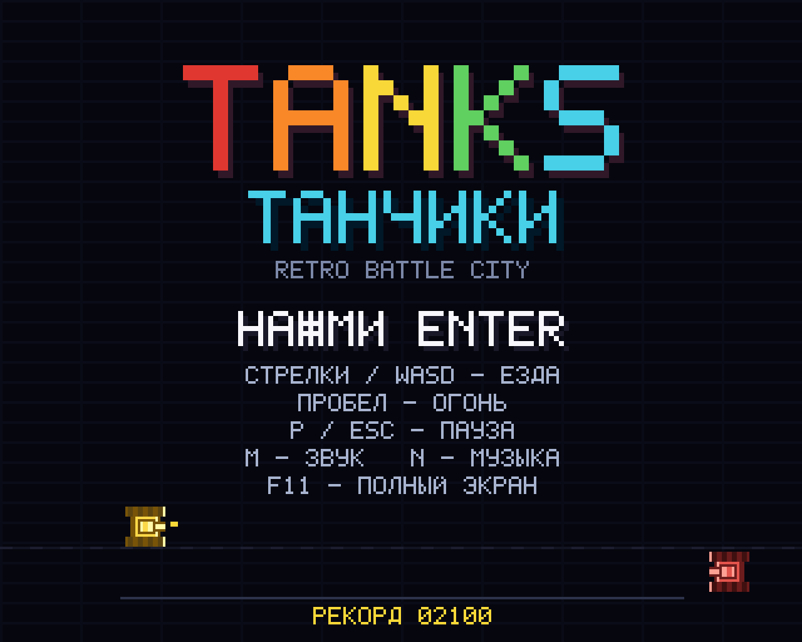

# TANKS — Retro Battle City

A retro-style multiplayer tank arcade game inspired by Battle City and SEGA classics. Destroy enemies, collect power-ups, and survive as long as possible.

## Screenshots




## How to Play

1. **Run the game**
   ```bash
   python tanks.py
   ```

2. **Controls**
   - **WASD / Arrow Keys** – Move
   - **Space** – Fire
   - **P** – Pause
   - **Esc** – Quit

3. **Objective**
   - Destroy all enemy tanks in each wave.
   - Collect power-ups to upgrade your weapon.
   - Protect your base and survive as long as possible.

## Features

- Retro pixel art graphics and chiptune sound.
- Multiple enemy types and challenging waves.
- Power-ups with various effects.
- Local two-player support (planned).
- CRT scanline effect for authentic feel.

## Development

- Built with **Python** and **Pygame**.
- Asset pipeline managed via `art.py`, `audio.py`, and `retro.py` modules.
- Level design in `world.py`.

## License

MIT License – feel free to fork and modify.